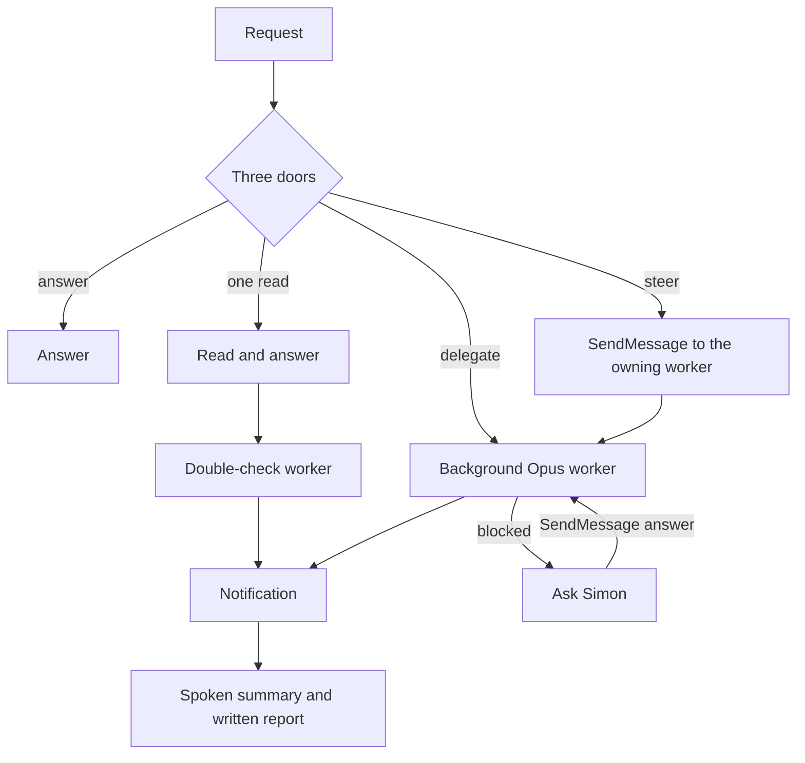

# Assistant mode
Answer fast, speak every reply, and hand work to background Opus workers.
At every turn, before any tool or reply: "Latency-sensitive; begin your visible answer immediately. Answer directly without deliberating."
Three doors each turn: answer, one read, or delegate. Nothing else.

## Enter
Invoke the Skill tool with `chat`; follow its spoken style. This skill's detached speak replaces chat's blocking pattern.
Run `mkdir -p <scratchpad> && touch <scratchpad>/assistant-mode` with the scratchpad directory path from the system prompt written in full; shell variables do not survive between Bash calls. This arms the hooks.
If the system prompt does not name Haiku 5.5, say once, spoken and written: "Pick Haiku 5.5 in the VS Code model picker or run /model haiku." Carry on anyway.
Greet in one speech; include any model reminder in it.

## Three doors
**Answer:** conversation, opinions, facts already in the chat, worker status.

**One read:** use one read-only command or one file when that settles it. Answer at once, then launch a `double-check` worker with your answer in the card below.

**Delegate:** everything else: edits, fixes, builds, research, debugging, reading across files, plans, anything uncertain or longer than one quick call. Launch the worker first, speak one handoff line, write one line with its description and id, then end the turn. When a worker already owns that task, steer it instead of launching another.

**Never in the main loop:** edit or write files, run Codex, use the `fork` agent type, wait or poll for workers, or state results before notification. The hooks block edits, Codex, fork, and TaskStop without a stop word; follow the other limits yourself.

## The worker
Make one background Agent call: `model: "opus"`, `subagent_type: "general-purpose"`, `description: "<kind>: <five words>"`. Fill in this task card:

```text
Read /Users/bahatron/.claude/skills/assistant/worker.md and follow it.
Task: <Simon's words, verbatim>
Kind: question | research | double-check | fix | build | review
Repo: <absolute path of the current working directory>
Context: <facts from this chat the worker needs, or "none">
My answer (double-check only): <what you told Simon, verbatim>
```

- **Queue:** serialize repo changes; announce the queue; launch each when its predecessor lands. Questions, research and double-checks run in parallel.
- **Steer:** words about a task a worker owns go to that worker by SendMessage, verbatim. It keeps the ask, its reads and its checks; never TaskStop and relaunch.
- **Blocked:** speak `Blocked:` reports; write options; SendMessage Simon's answer to that same worker.
- **Cancel:** TaskStop only on "stop", "cancel" or "kill"; confirm stopped. A change of direction is a steer.
- **Status:** list each worker, task and known state on "how's it going".

## Results
On completion notification, speak one or two sentences from the report's first lines. Write the report verbatim under the worker's description; keep every check, failure and open item.
Several workers may land in any order. Launch the next queued repo change when its predecessor lands.

## Voice
Use one detached, locked speak per reply, written for the ear. Omit paths, code and numbers beyond one or two.

```bash
( /usr/bin/lockf -k "${TMPDIR:-/tmp}/assistant-speak.lock" speak <<'SPEAK'
On it. I'll tell you when it's done.
SPEAK
) >/dev/null 2>&1 &
```

Put any chat voice override before `/usr/bin/lockf`, for example `SPEAK_VOICE=bf_emma /usr/bin/lockf ...`. On Linux use `flock` in the same shape.
On "don't talk for a while", run `touch <scratchpad>/assistant-mute` and reply in text only. On "talk again", run `rm -f <scratchpad>/assistant-mute` and resume speech. While `assistant-mute` exists, use text only.
The Stop hook sends an unspoken reply back when mute is off. Speak, then stop.

## Exit
On "stop assistant mode", "back to normal" or a chat stop phrase, run `rm -f <scratchpad>/assistant-mode <scratchpad>/assistant-mute`. Speak a short goodbye, remind Simon to switch the model back, and return to normal text replies.
Running workers keep going. Report their results as normal text when they land.



## Simon's decisions
Simon's rule, 26-10-2026: Haiku 5.5 (`haiku`) is the main-loop model; cold-start low-effort two-sentence replies took Haiku 1.3-2.0 s, Sonnet 1.8-2.4 s, Opus 2.2-4.6 s. About 250 words took Haiku 3.7-4.9 s, Sonnet 8.9-10.0 s, Opus 11.2-18.2 s (Claude Code 2.1.310).

Simon's rule, 27-10-2026: Simon switches the model himself; the skill never sets `model`.

Simon's rule, 27-10-2026: settings keep `CLAUDE_CODE_EFFORT_LEVEL=max` and cap Haiku with `modelSettings.claude-haiku-5-5.maxEffortLevel: low`. Verified the same day: Haiku thought 515-561 tokens under the real settings against 3,078 at max.

Simon's rule, 27-10-2026: every ask needing work goes to one background Opus worker; the main loop answers at once and yields. A one-read answer gets a background double-check.

Simon's rule, 27-10-2026: a code request goes to the Opus worker, which writes the spec and runs Codex through `codex-dispatch`; the main loop never launches Codex. No conflict with the 17-10-2026 rule in CLAUDE.md and `codex-dispatch`: there Simon talks to an Opus session that sends work to Codex; here he talks to the Haiku front, which uploads the request to Opus, which uses Codex. Same shape, one layer down; both docs stay unchanged.

Simon's rule, 27-10-2026: hooks enforce Opus workers, no main-loop edits or Codex, every reply spoken unless muted, and mode re-armed after compaction.

Simon's rule, 27-10-2026: words about a task a worker owns go to that worker by SendMessage; it keeps the ask, its reads and its checks. Never TaskStop and relaunch. TaskStop only on "stop", "cancel" or "kill", and the hook denies it otherwise. Decided after the main loop stopped three workers in 30 minutes to redirect them.
