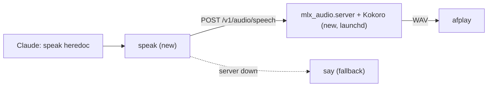
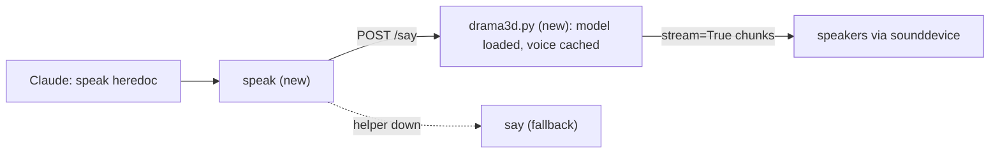

# TTS engine for the chat skill

Web research on 17-10-2026 for `speak` on the M5 Max (48 GB, macOS 26.7.1). Nothing was installed on this Mac and only `say` was timed here; other Mac numbers name their chip. The main session checked the Supertonic, Drama 3 and Elo claims against their sources.

## Answer

**Kokoro-82M on mlx-audio** (proven, 355 MB, about 1 s to first audio), then **Fish Audio Drama 3** (best open voice, 26 GB RAM, weights 4 days old).

## Comparison

| Engine | Quality score | Mac latency: first audio, speed | Size | Install | License | Last release |
|---|---|---|---|---|---|---|
| **Kokoro-82M v1.0** | AA 1061 ±11 ([AA][aa]); V2 1473 ([V2][v2]) | 1.09 s, 16.2x on MLX ([CSV][tbcsv]); M4 Max: 22x ([vllm-mlx][vm]) | 82M params, 355 MB ([HF][kmlx]) | `uv tool install mlx-audio` + misaki | Apache 2.0 ([HF][kokoro]) | Weights 27-01-2025; mlx-audio 0.5.9 on 13-10-2026 ([PyPI][mlxpypi]) |
| **Fish Audio Drama 3** | AA 1244 ±15 as "Drama 3 Preview", best open model ([AA][aa]) | M3 Max, 4-bit: 0.16 s to 0.20 s streamed, about 2x (port author); M5 Max, 3-bit: about 1.7x ([PR][d3pr], [MLX][d3mlx]) | 35B MoE, 3B active; 22 GB at 4-bit ([MLX][d3mlx]) | mlx-audio from git (support merged 14-10-2026) | FACL v1.0: commercial only under USD 500k revenue ([license][facl]) | 13-10-2026 ([HF][d3hf]) |
| **Pocket TTS** | Not ranked; Kyutai's test: 2016 vs Chatterbox Turbo 2055 (vendor claim) ([paper][calm]) | 0.04 s streamed, 8.6x to 9.1x on CPU ([CSV][tbcsv]) | 100M params, 242 MB ([Picovoice][pv]) | `uv tool install pocket-tts` | MIT code, CC-BY-4.0 weights ([HF][pockethf]) | 3.3.0 on 24-09-2026 ([PyPI][pocketpypi]) |
| **Voxtral 4B TTS** | AA 1087 ±12 ([AA][aa]) | 10.4 s to 18.8 s, 1.2x ([CSV][tbcsv]); base M5, MLX 4-bit: RTF 0.70 ([skill][vxsk]) | 4B params, 2.5 GB at 4-bit ([guide][vxil]) | mlx-audio | CC BY-NC 4.0 ([HF][vxhf]) | 26-03-2026 ([news][vxnews]) |
| **Qwen3-TTS** | Not ranked; AA's 932 entry looks like the hosted API ([AA][aaqwen]) | M4 and M1 Max on MLX: 0.09 s to 0.19 s streamed; RTF 0.29 cold, 1.0 hot ([issue][qwenmac]) | 0.6B and 1.7B; 1.4 GB at 4-bit ([issue][qwenmac]) | mlx-audio | Apache 2.0 ([HF][qwenhf]) | Weights 22-01-2026 ([repo][qwen]) |

- **AA, V2:** human-vote Elo from Artificial Analysis (±95% interval) and TTS Arena V2.
- **Elo gap:** 183 points predicts Drama 3 wins about 74% of votes against Kokoro.
- **Mac timings:** warm runs of tts-bench prompt 3 on a base M4, unless named.
- **Headroom:** base M4 moves 120 GB/s ([Apple][m5mlx]); M5 Max up to 614 GB/s ([wiki][m5wiki]).
- **Cloud reference:** Eleven v4 Turbo leads AA at 1330 ±18, 269 above Kokoro ([AA][aa]).

Prompt 3 yields 10 to 25 s of audio depending on the engine, near a 40-word reply. The M5 Max has 5x the base M4's memory bandwidth, so the base M4 rows are pessimistic. "Speed" is seconds of audio per second of compute; RTF is the inverse.

The real choice: a proven 355 MB voice now, or the best open voice for 26 GB of RAM and a 4-day-old release, both on mlx-audio.

## Pick 1: Kokoro-82M on mlx-audio

### Why

- **Proven quality:** AA 1061 ±11, V2 1473; fastest arena-ranked engine on tts-bench's Mac.
- **Speed:** base M4 renders 17.8 s of audio in 1.09 s, 16.2x ([CSV][tbcsv]).
- **Faster chips:** 22x real time on M4 Max ([vllm-mlx][vm]), 23.8x on M4 Pro ([FluidAudio][fa]).
- **Open license:** Apache 2.0 weights, commercial use allowed ([HF][kokoro]).
- **Live runtime:** mlx-audio shipped 10 releases since 17-08-2026 ([PyPI][mlxpypi]).

### Cost

- **Disk:** 355 MB MLX weights ([HF][kmlx]) plus a Python 3.12 env (size unmeasured).
- **RAM:** 774 MB peak on a base M4 ([tb][tb]).
- **Install:** three steps: Homebrew packages, one `uv tool install`, one launchd agent.
- **Cold start:** 3.09 s for the first call after loading; keep it warm ([CSV][tbcsv]).

### What we give up

- **Voice quality:** Drama 3 scores 183 Elo higher ([AA][aa]).
- **Chunked, not streamed:** each text chunk renders whole before it plays ([FluidAudio][fa]).
- **Voices:** no cloning; only 2 of 28 English voices grade A or A- ([voices][kvoices]).
- **Frozen upstream:** weights 27-01-2025; `kokoro` package last released 05-04-2025 ([PyPI][kpypi]).
- **MLX bug:** intermittent shape crash; a July report is unanswered ([CSV][tbcsv], [HF][kmlxbug]).

### Install sketch (untested)

```bash
brew install uv jq   # uv fetches Python 3.12 itself; system 3.9.6 stays as is
# misaki (Kokoro's G2P) runs spacy.cli.download on first use; preinstall the model
uv tool install --force --python 3.12 mlx-audio --prerelease=allow \
  --with "misaki[en]" \
  --with "en_core_web_sm @ https://github.com/explosion/spacy-models/releases/download/en_core_web_sm-3.8.0/en_core_web_sm-3.8.0-py3-none-any.whl"
# Run from a launchd agent (KeepAlive) so the model stays in memory:
mlx_audio.server --host 127.0.0.1 --port 8000
```

Acceptance test: speak 20 replies of mixed length; one crash means switching runtime. Kokoro-FastAPI runs the PyTorch package on MPS behind the same OpenAI route ([repo][kfa]), and PyTorch Kokoro logged no failures at 16.1x to 16.5x on prompt 3 ([CSV][tbcsv]).

### How `speak` calls it



```bash
#!/usr/bin/env bash
# speak: text on stdin -> Kokoro on a warm mlx-audio server -> speakers
set -euo pipefail
text=$(cat)
dir=$(mktemp -d); trap 'rm -rf "$dir"' EXIT
body=$(jq -n --arg t "$text" --arg v "${SPEAK_VOICE:-af_heart}" \
  '{model: "mlx-community/Kokoro-82M-bf16", input: $t, voice: $v, response_format: "wav"}')
if curl -sf -H 'Content-Type: application/json' -d "$body" \
     -o "$dir/reply.wav" http://127.0.0.1:8000/v1/audio/speech; then
  afplay "$dir/reply.wav"
else
  say "$text"
fi
```

The server defaults to MP3 and loads a model on its first request ([server.py][mlxserver]). Switching to Kokoro-FastAPI changes only the port (8880) and model name ([repo][kfa]). `SPEAK_VOICE` replaces the old `PIPER_VOICE` override.

## Pick 2: Fish Audio Drama 3 on mlx-audio

### Why

- **Best open voice:** AA 1244 ±15, 10th of 97, above Eleven v3 ([AA][aa]).
- **Fast start:** first audio in 0.16 s to 0.20 s on M3 Max ([PR][d3pr]).
- **Keeps up:** about 2x real time on M3 Max (4-bit); 36 frames/s, 1.7x, on M5 Max (3-bit) ([MLX][d3mlx], [PR][d3pr]).
- **Fits 48 GB:** peaks at 26 GB (4-bit) or 24 GB (3-bit) ([MLX][d3mlx], [PR][d3pr]).
- **Same runtime:** mlx-audio merged Drama 3 support on 14-10-2026 ([PR][d3pr]).

### Cost

- **Disk:** 22 GB at 4-bit, 18.5 GB at 3-bit ([MLX][d3mlx], [PR][d3pr]).
- **RAM:** 26 GB held while loaded, so run it only during chat ([MLX][d3mlx]).
- **Install:** mlx-audio from git until the next PyPI release ([PyPI][mlxpypi], [PR][d3pr]).
- **Voice prep:** a clean reference clip plus its transcript; 44.1 kHz advised ([PR][d3pr]).
- **Glue:** a small resident Python helper that streams chunks to the speakers.

### What we give up

- **Maturity:** 4-day-old weights; unofficial MLX build; open silent-chunk bug #1026 ([MLX][d3mlx], [PR][d3pr]).
- **Unverified locally:** AA scored "Drama 3 Preview"; the 4-bit build has no listening test ([AA][aa], [MLX][d3mlx]).
- **License cap:** work use counts as commercial; free only under USD 500k yearly revenue ([license][facl]).
- **No presets:** every voice needs a reference clip; uncached first calls are untimed ([PR][d3pr]).
- **Tag mismatch:** HF metadata says research license; the LICENSE file says FACL v1.0 ([HF][d3hf]).

### Install sketch (untested)

```bash
brew install uv
mkdir -p ~/.local/share/speak   # voice.wav (clean, 44.1 kHz) and voice.txt (its transcript)
# Run from a launchd agent that chat mode starts and stops; first run pulls 22 GB:
uv run --script ~/.local/bin/drama3d.py
```

```python
# /// script
# requires-python = ">=3.10"
# dependencies = ["mlx-audio @ git+https://github.com/Blaizzy/mlx-audio.git", "sounddevice"]
# [tool.uv]
# prerelease = "allow"
# ///
# drama3d.py: load once, then serve POST /say on 127.0.0.1:8765
from mlx_audio.tts.utils import load_model
model = load_model("mlx-community/fish-audio-drama-3-4bit")
# per request: for r in model.generate(text=..., ref_audio=..., ref_text=..., stream=True):
#     write r.audio to a sounddevice OutputStream; reply when playback ends
```

### How `speak` calls it



```bash
#!/usr/bin/env bash
# speak: text on stdin -> resident Drama 3 helper -> speakers, streamed
text=$(cat)
printf '%s' "$text" | curl -sf --data-binary @- http://127.0.0.1:8765/say \
  || say "$text"
```

The helper calls mlx-audio's `generate(..., stream=True)`, which yields 44.1 kHz chunks ([MLX][d3mlx]). mlx-audio's own server encodes every streamed chunk as a separate file ([server.py][mlxserver]), so a plain `curl | ffplay` client needs a test before it can replace the helper.

## Supertonic verdict

**Skip it:** its maker is being dissolved, the repo is archived, and no human-vote score exists.

### What it is

- **Real and open-weight:** ONNX TTS; v3 has ~99M params, 10 presets ([repo][st], [SDK][stpy]).
- **English:** v3 speaks 31 languages, English included; v1 was English-only ([repo][st]).
- **License:** MIT code; OpenRAIL-M weights allow commercial use with use limits ([license][stlic]).
- **Weights still download:** the v2 and v3 Hugging Face repos stay live ([HF][st3]).

### Why not

- **Maker dissolved:** HYBE is liquidating Supertone; dissolution approved 15-07-2026 ([news][hybe]).
- **Archived:** repo read-only since 09-09-2026; no fixes or security patches ([repo][st]).
- **Speed gap:** vendor peak 167x on M4 Pro ([HF][st2]); tts-bench 4.81x on M4 ([tb][tb]).
- **Quality unproven:** no arena entry; English WER 1.54 vs Kokoro 1.46 ([summary][ot]).
- **Fast mode sounds worse:** UTMOS 1.53 at 2 steps, 4.32 at 5 ([HeyNEO][neo]).

## Ruled out

### Close calls

- **Pocket TTS:** 0.04 s streamed on M4 CPU, clones voices; quality unranked ([CSV][tbcsv]).
- **Voxtral 4B:** AA 1087, but 10.4 s first audio on M4; non-commercial ([CSV][tbcsv]).
- **Qwen3-TTS:** 0.1 s streamed on MLX, but only 2 English presets, both male ([HF][qwenhf]).
- **Magpie 357M:** AA 1063; Swift port starts in 0.12 s, barely real time ([guide][magpie]).
- **Higgs TTS 2:** RTF 0.33 on M5 Max (port claim); unranked ([README][higgs2]).

### Too slow on a Mac

- **Chatterbox Turbo, Flash:** 9.3 s+ on M4; Flash MLX at RTF 0.67 ([CSV][tbcsv], [HF][cbflash]).
- **VibeVoice Realtime 0.5B:** 16.3 s to 17.1 s on M4 GPU; research-only ([CSV][tbcsv], [repo][vibevoice]).
- **Maya1:** AA 1046; only its 4-bit MLX port beats real time (M4 Max) ([HF][mayamlx]).
- **F5-TTS, VoxCPM2:** 45.5 s and 52.1 s first audio on M4 ([tb][tb]).
- **IndexTTS2:** 48.4 s on M4 CPU; Metal port RTF 0.82 to 1.71 ([tb][tb], [port][indexmac]).

### Needs NVIDIA, or non-commercial

- **Breeze TTS 2:** AA 1222; official code needs NVIDIA; weights non-commercial ([HF][breeze]).
- **Fish S2 Pro, S1-mini:** AA 1116 and 1044; non-commercial weights ([S2][s2pro], [S1][s1mini]).
- **Step-Audio-EditX:** AA 1097; needs a 12 GB NVIDIA GPU; weights license unstated ([repo][stepx]).
- **Spark-TTS:** weights moved from Apache 2.0 to CC BY-NC-SA 4.0 ([HF][spark]).
- **OmniVoice, Higgs TTS 3:** non-commercial weights ([HF][omni], [HF][higgs3]).

### No fixed voice, or weak scores

- **CSM-1B, Dia:** random voice per run; Dia2 is CUDA-only ([CSM][csm], [Dia][dia], [Dia2][dia2]).
- **CosyVoice 3, NeuTTS Air:** cloning only, no preset voices ([CosyVoice][cosy], [NeuTTS][neutts]).
- **Orpheus 3B:** MUSHRA 27.1 in Kyutai's test; idle since 05-12-2025 ([paper][dsm], [repo][orpheus]).
- **Kyutai TTS 1.6B:** MUSHRA 54.8 vs ElevenLabs Flash 65.0; MLX gaps ([paper][dsm], [issue][dsmgap]).
- **Soprano 1.1, Kitten TTS:** no independent quality scores; Soprano idle since 15-01-2026 ([Soprano][soprano], [Kitten][kitten]).

### Baselines and dead ends

- **Piper (old baseline):** 0.44 s to 0.46 s on M4; no quality score ([CSV][tbcsv]).
- **Piper license:** code now GPL-3.0; lessac voice data is research-only ([PyPI][piper], [lessac][lessac]).
- **macOS `say`:** zero install; 9.6 s of audio in 1.7 s here; unranked; no Siri voices ([help][applesay], [notes][sayvoices]).
- **Marvis 250M:** unmaintained since 11-2025; warns of hallucinated words ([repo][marvis]).
- **VibeVoice 1.5B, 7B:** Microsoft removed the TTS code on 05-09-2025 ([repo][vibevoice]).

## Sources

### Rankings and quality

- **Arenas, fetched 17-10-2026:** [Artificial Analysis][aa], [its Qwen3 entry][aaqwen], [TTS Arena V2][v2]
- **Open TTS Leaderboard (WER):** [Space][otl], [30-09-2026 results summary][ot]
- **Kyutai human tests:** [CALM paper, Table 12][calm], [DSM paper, Table 5][dsm]
- **Automated MOS on CPU:** [HeyNEO, 06-07-2026][neo]

### Mac benchmarks and hardware

- **tts-bench, base M4 16 GB:** [speed table][tb], [per-run CSV][tbcsv]
- **Kokoro elsewhere:** [vllm-mlx][vm], [FluidAudio][fa], [Picovoice CPU][pv]
- **Other ports:** [Qwen3 MLX][qwenmac], [Magpie Swift][magpie], [Maya1 MLX][mayamlx], [IndexTTS2 Metal][indexmac], [Higgs MLX][higgs2]
- **Apple chips:** [MLX on M5][m5mlx], [M5 specs][m5wiki]

### The two picks

- **Kokoro:** [card][kokoro], [voice grades][kvoices], [PyPI][kpypi], [MLX weights][kmlx], [crash report][kmlxbug]
- **Runtimes:** [mlx-audio][mlxa], [PyPI][mlxpypi], [server.py][mlxserver], [Kokoro-FastAPI][kfa], [uv][uv]
- **Text front end:** [misaki en.py][misakien], [en_core_web_sm 3.8.0][spacy]
- **Drama 3:** [card][d3hf], [FACL v1.0][facl], [mlx-audio PR #1018][d3pr], [4-bit MLX build][d3mlx]

### Compared engines

- **Pocket TTS, Qwen3-TTS:** [Pocket repo][pocket], [Pocket card][pockethf], [Pocket PyPI][pocketpypi], [Qwen3 repo][qwen], [Qwen3 card][qwenhf]
- **Voxtral:** [card][vxhf], [Mac guide][vxil], [M5 skill][vxsk], [launch news][vxnews]
- **Supertonic:** [repo][st], [v2 card][st2], [v3 card][st3], [license][stlic]
- **Supertonic's end:** [HYBE news][hybe], [archived SDK][stpy]
- **Chatterbox, VibeVoice:** [Flash card][cbflash], [VibeVoice repo][vibevoice]

### Ruled-out engines

- **Licenses:** [Breeze][breeze], [S2 Pro][s2pro], [S1-mini][s1mini], [Spark][spark], [Higgs 3][higgs3]
- **Hardware and voices:** [Step-Audio-EditX][stepx], [OmniVoice][omni], [CSM][csm], [Dia][dia], [Dia2][dia2]
- **Activity:** [CosyVoice][cosy], [NeuTTS][neutts], [Orpheus][orpheus], [Soprano][soprano], [Kitten][kitten]
- **Kyutai, Piper, Marvis:** [DSM issue][dsmgap], [Piper PyPI][piper], [lessac license][lessac], [Marvis][marvis]
- **macOS say:** [Apple help][applesay], [say voice notes][sayvoices]

[aa]: https://artificialanalysis.ai/text-to-speech/leaderboard
[aaqwen]: https://artificialanalysis.ai/text-to-speech/models/qwen3-tts-vc-realtime
[v2]: https://tts-agi-tts-arena-v2.hf.space/leaderboard
[otl]: https://huggingface.co/spaces/hf-audio/open_tts_leaderboard
[ot]: https://www.creativeainews.com/articles/open-tts-leaderboard-license-cpu-test-2026/
[calm]: https://arxiv.org/html/2509.06926v3
[dsm]: https://arxiv.org/html/2509.08753
[neo]: https://heyneo.com/blog/kokoro-supertonic-inflect-nano-pocket-tts-cpu-benchmark
[tb]: https://5uck1ess.github.io/tts-bench/speed.html
[tbcsv]: https://5uck1ess.github.io/tts-bench/mac-default/results.csv
[vm]: https://github.com/waybarrios/vllm-mlx/blob/main/docs/benchmarks/audio.md
[fa]: https://docs.fluidinference.com/tts/kokoro
[pv]: https://picovoice.ai/blog/on-device-tts/
[qwenmac]: https://github.com/ThinkFlowLab/vllm-omni-mlx/issues/84
[magpie]: https://soniqo.audio/guides/magpie
[mayamlx]: https://huggingface.co/0xhb/maya1-mlx-4bit
[indexmac]: https://github.com/raoqu/index-tts2-metal
[higgs2]: https://github.com/Blaizzy/mlx-audio/tree/main/mlx_audio/tts/models/higgs_audio
[m5mlx]: https://machinelearning.apple.com/research/exploring-llms-mlx-m5
[m5wiki]: https://en.wikipedia.org/wiki/Apple_M5
[kokoro]: https://huggingface.co/hexgrad/Kokoro-82M
[kvoices]: https://huggingface.co/hexgrad/Kokoro-82M/blob/main/VOICES.md
[kpypi]: https://pypi.org/project/kokoro/
[kmlx]: https://huggingface.co/mlx-community/Kokoro-82M-bf16
[kmlxbug]: https://huggingface.co/mlx-community/Kokoro-82M-bf16/discussions/5
[mlxa]: https://github.com/Blaizzy/mlx-audio
[mlxpypi]: https://pypi.org/project/mlx-audio/
[mlxserver]: https://github.com/Blaizzy/mlx-audio/blob/main/mlx_audio/server.py
[kfa]: https://github.com/remsky/Kokoro-FastAPI
[uv]: https://docs.astral.sh/uv/guides/install-python/
[misakien]: https://github.com/hexgrad/misaki/blob/main/misaki/en.py
[spacy]: https://github.com/explosion/spacy-models/releases/tag/en_core_web_sm-3.8.0
[d3hf]: https://huggingface.co/fishaudio/drama-3
[facl]: https://huggingface.co/fishaudio/drama-3/blob/main/LICENSE
[d3pr]: https://github.com/Blaizzy/mlx-audio/pull/1018
[d3mlx]: https://huggingface.co/mlx-community/fish-audio-drama-3-4bit
[pocket]: https://github.com/kyutai-labs/pocket-tts
[pockethf]: https://huggingface.co/kyutai/pocket-tts
[pocketpypi]: https://pypi.org/project/pocket-tts/
[vxhf]: https://huggingface.co/mistralai/Voxtral-4B-TTS-2603
[vxil]: https://insiderllm.com/guides/mistral-voxtral-tts-local-voice-ai/
[vxsk]: https://skillsmp.com/creators/enconvo/skills/curated-voxtral-tts
[vxnews]: https://siliconangle.com/2026/03/26/mistral-releases-open-weights-speaking-ai-model-voxtral-tts/
[qwen]: https://github.com/QwenLM/Qwen3-TTS
[qwenhf]: https://huggingface.co/Qwen/Qwen3-TTS-12Hz-0.6B-CustomVoice
[st]: https://github.com/supertone-inc/supertonic
[st2]: https://huggingface.co/Supertone/supertonic-2
[st3]: https://huggingface.co/Supertone/supertonic-3
[stlic]: https://huggingface.co/Supertone/supertonic-3/blob/main/LICENSE
[stpy]: https://github.com/supertone-oss-archive/supertonic-py
[hybe]: https://www.digitalmusicnews.com/2026/07/28/hybe-liquidates-supertone-after-acquisition/
[cbflash]: https://huggingface.co/ResembleAI/chatterbox-flash
[vibevoice]: https://github.com/microsoft/VibeVoice
[breeze]: https://huggingface.co/BreezeBlue/Breeze-TTS-2
[s2pro]: https://huggingface.co/fishaudio/s2-pro
[s1mini]: https://huggingface.co/fishaudio/s1-mini
[stepx]: https://github.com/stepfun-ai/Step-Audio-EditX
[spark]: https://huggingface.co/SparkAudio/Spark-TTS-0.5B
[omni]: https://huggingface.co/k2-fsa/OmniVoice
[higgs3]: https://huggingface.co/bosonai/higgs-tts-3-4b
[csm]: https://github.com/SesameAILabs/csm
[dia]: https://github.com/nari-labs/dia
[dia2]: https://github.com/nari-labs/dia2/blob/main/pyproject.toml
[cosy]: https://github.com/FunAudioLLM/CosyVoice
[neutts]: https://github.com/neuphonic/neutts
[orpheus]: https://github.com/canopyai/Orpheus-TTS
[soprano]: https://github.com/ekwek1/soprano
[kitten]: https://github.com/KittenML/KittenTTS
[dsmgap]: https://github.com/kyutai-labs/delayed-streams-modeling/issues/170
[piper]: https://pypi.org/project/piper-tts/
[lessac]: https://www.cstr.ed.ac.uk/projects/blizzard/2013/lessac_blizzard2013/license.html
[marvis]: https://github.com/Marvis-Labs/marvis-tts
[applesay]: https://support.apple.com/guide/mac-help/change-the-voice-your-mac-uses-to-speak-text-mchlp2290/mac
[sayvoices]: https://www.alanwsmith.com/en/2w/gw/r3/4n/

## Decision

**Kokoro-82M on mlx-audio for macOS,** chosen by Simon on 17-10-2026. **Linux keeps Piper** (`en_US-lessac-medium`) for now, to revisit later.

- **Why:** Drama 3 holds 26 GB of the 48 GB while loaded; it would clog the laptop.
- **Accepted trade-off:** Drama 3 wins about 74% of blind votes against Kokoro.
- **Replaces on macOS:** Piper with `en_US-lessac-medium`, whose voice data is research-only.
- **Revisit:** Drama 3 if a build fits in memory without clogging the laptop.
- **Built:** `speak-setup.sh` (port 7341) replaces the sketch above; 13 s of audio renders in 0.4 s here.

Measured here on 17-10-2026: the Kokoro server holds 0.7 to 0.8 GB and peaks at 3.7 to 5.0 GB (physical footprint, mostly GPU) while rendering. A 40-word reply takes 0.3 to 0.4 s back to back and 1.3 to 2.1 s after a 20 s pause. Piper's macOS wheel (piper-tts 1.8.0) fails at import on a hard-coded espeak-ng data path, so Piper was not timed here.
